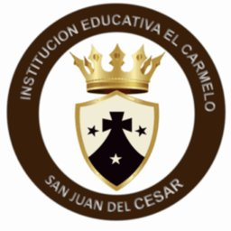

<p align="center"></p>

# Aula Digital El Carmelo – Prototipo funcional (TRL 5)

Prototipo web de una plataforma digital de aprendizaje para apoyar la transición de la enseñanza tradicional hacia entornos educativos digitales en la **Institución Educativa El Carmelo** de San Juan del Cesar, La Guajira (Colombia).

## Datos del proyecto
| | |
|---|---|
| **Proyecto** | Diseño y validación de una plataforma digital de aprendizaje para apoyar la transición de la enseñanza tradicional hacia entornos educativos digitales en la I.E. El Carmelo de San Juan del Cesar, La Guajira |
| **Curso** | Proyecto de grado (202016907) – Fase 4: Desarrollo de la propuesta ingenieril |
| **Autora** | Eucarlos Gamez Cuello |
| **Programa** | Ingeniería de Sistemas, Escuela de Ciencias Básicas, Tecnología e Ingeniería (ECBTI) |
| **Universidad** | Universidad Nacional Abierta y a Distancia (UNAD) |
| **Tutor** | Orlando Gómez Barboza |
| **Año** | 2026 |

## Problema que atiende
La institución aprende todavía con métodos tradicionales y presenciales, en un contexto de brecha digital (conectividad, dispositivos y competencias). El prototipo propone una plataforma liviana, usable desde el celular y que funciona con poca conectividad.

## Qué incluye el prototipo
- **Cuatro roles:** estudiante, docente, administrador y directivo.
- **Cursos de demostración** (Matemáticas, Lenguaje y Ciencias Naturales) con actividades organizadas por los seis niveles de la Taxonomía de Bloom.
- Descarga de recursos y uso **sin conexión** (Service Worker).
- Cuestionarios con retroalimentación inmediata, entrega de tareas, foro y avisos.
- Calificaciones, informes de participación y de uso, copia de respaldo y escala de usabilidad **SUS**.
- Diseño móvil primero, un archivo liviano (≈14 KB) y modo oscuro.

## Metodología
Ciencias del diseño, **Scrum** (2 sprints en la Fase 4), modelo **ADDIE** y marco **CDIO**. La ruta de producción prevista es **Moodle + H5P**; este prototipo reproduce su estructura (cursos, unidades, actividades, calificaciones, informes) para validar flujos y usabilidad.

## Cómo usarlo
1. Abre la página publicada en GitHub Pages (enlace en el repositorio).
2. Ingresa con un usuario de prueba y la contraseña `1234`:

| Usuario | Rol |
|---|---|
| `est` | Estudiante |
| `doc` | Docente |
| `adm` | Administrador |
| `dir` | Directivo |

También puedes ejecutarlo localmente: `python3 -m http.server 8765` y abrir http://127.0.0.1:8765

## Pruebas
Pruebas automatizadas con Playwright (celular emulado, red de 1 Mbps y modo sin conexión):
```
pip install playwright
playwright install chromium
python3 tests/test_prototipo.py
```
Resultados de la última ejecución: 7 de 7 pruebas funcionales del alcance superadas; primera carga en 0,49 s a 1 Mbps.

## Alcance y limitaciones
- Los datos son **de demostración** y se guardan solo en el navegador de cada dispositivo (no hay base de datos compartida).
- Quedan fuera del prototipo: creación de cursos, banco de preguntas, rúbricas y carga masiva de usuarios (se resuelven con Moodle).
- La usabilidad (SUS), la aceptación (TAM) y la apropiación (ICDA) se medirán con usuarios reales en la prueba piloto.

## Estructura del repositorio
```
index.html          Prototipo (aplicación de una sola página)
sw.js               Service Worker para uso sin conexión
assets/logo.jpg     Escudo de la institución
tests/              Pruebas automatizadas
docs/capturas/      Capturas de pantalla del prototipo
```

> El escudo pertenece a la Institución Educativa El Carmelo y se usa con fines académicos.
